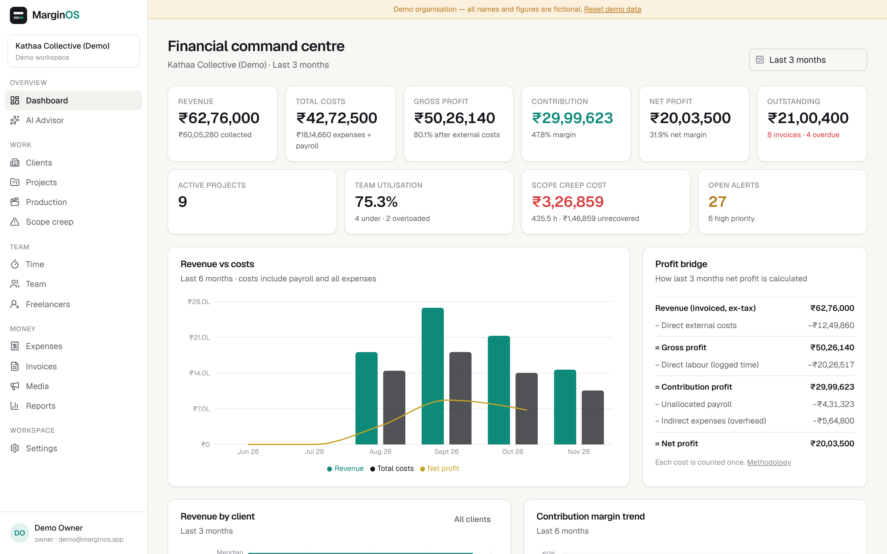
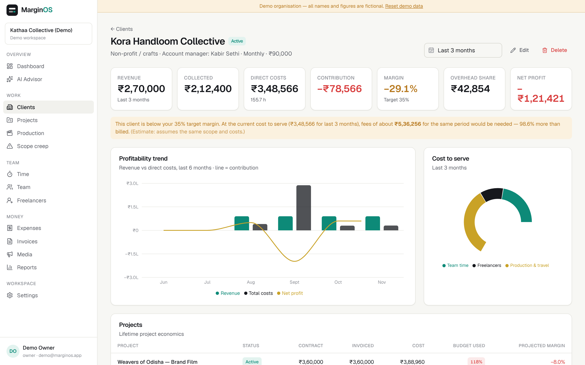
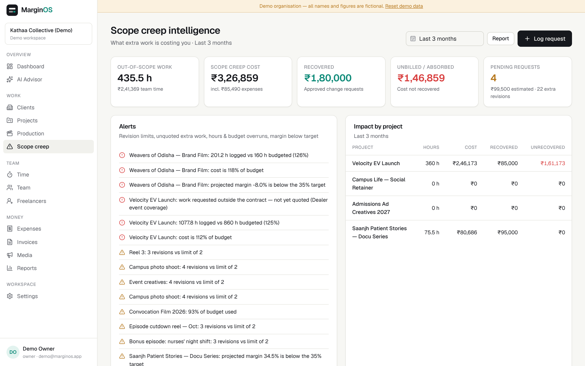
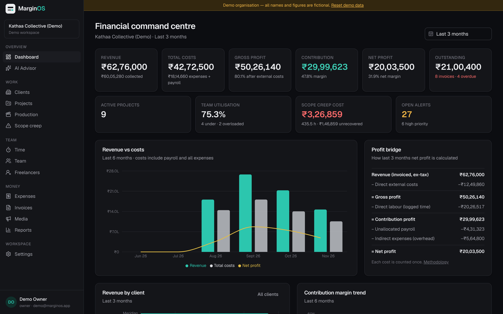
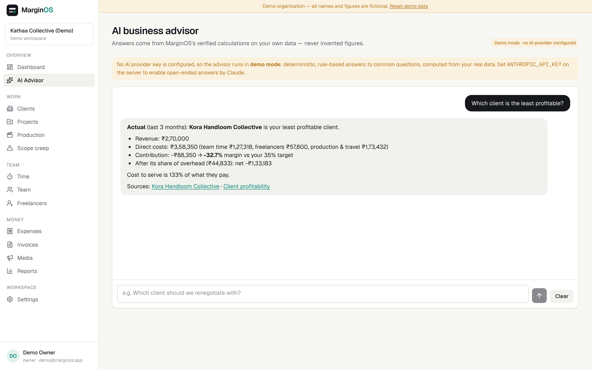
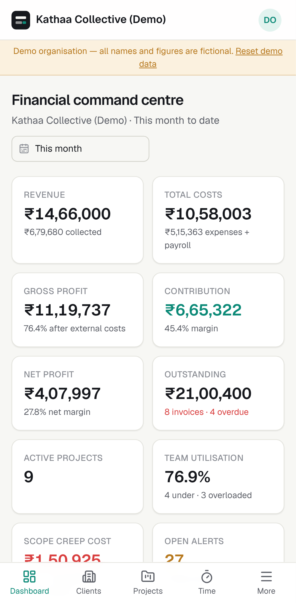
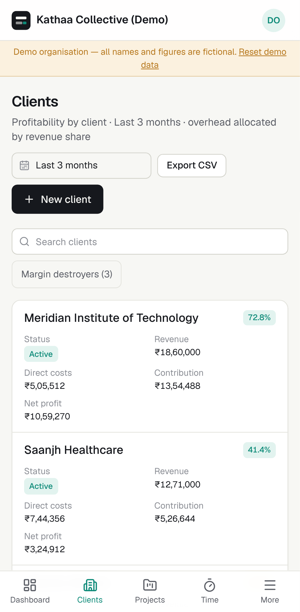
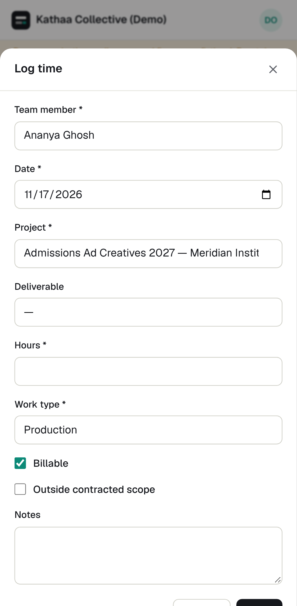

# MarginOS

**Know your margins. Control your agency.**

MarginOS is a multi-tenant SaaS for creative, branding, social, video-production and marketing agencies. It shows what each client, project, person and deliverable *actually* earns after team time (at loaded cost), freelancers, production, travel, revisions, software and overhead.



| | |
|---|---|
|  |  |
|  |  |

<p>  </p>

## What's inside

- **Financial command centre**: revenue, costs, gross/contribution/net profit, receivables, utilisation, scope-creep cost and alerts, with date filters and drill-down. Every figure is computed from database records.
- **Client and project profitability**: contribution margin, overhead allocation, budget vs actual, projected margin, and a filter for "margin destroyers".
- **Creative production economics**: cost per reel, video, graphic and shoot day.
- **Scope-creep intelligence**: out-of-scope time and cost, alerts, change requests (log → quote → client approval → draft invoice).
- **Team and freelancers**: loaded hourly cost, utilisation, under- and over-loaded staff, in-house vs freelancer cost.
- **Expenses, invoices and payments**: recurring expenses, vendors, refunds, credit notes, aging, CSV import and export.
- **Media economics**: media spend kept separate from agency fees.
- **Reports**: 9 report types, printable (browser → PDF) and downloadable as CSV.
- **AI advisor**: Claude explains the engine's verified numbers. Without a key it runs a labelled rule-based demo mode.
- **Client portal**: clients approve deliverables and change requests, and see their invoices and shared reports.
- **Onboarding, roles (6), invitations, audit log, demo organisation with reset, installable PWA.**

See **[docs/STATUS.md](docs/STATUS.md)** for exactly what is fully functional, simulated, or waiting on external credentials.

## Quick start (local)

Requirements: Node 20+ (tested on 22), PostgreSQL 14+ (tested on 16).

```bash
cd marginos
npm install                      # also runs `prisma generate`
cp .env.example .env             # set DATABASE_URL and APP_URL
npm run db:migrate               # apply migrations
npm run db:seed                  # create the demo organisation (idempotent)
npm run dev                      # http://localhost:3000
```

Demo logins (fictional data, isolated demo workspace):

| Who | Email | Password |
|---|---|---|
| Agency owner | `demo@marginos.app` | `MarginOS-demo-2026` |
| Client portal user (Meridian) | `portal@meridian.demo` | `Meridian-portal-2026` |

Or click **Open demo workspace** on the sign-in page. To start a real agency, choose **Create an account**. Real workspaces never receive demo data.

## Scripts

| Command | Purpose |
|---|---|
| `npm run dev` / `npm run build` / `npm start` | Develop / production build / serve |
| `npm run db:migrate` | Apply migrations (`prisma migrate deploy`) |
| `npm run db:seed` | Create or reset the demo organisation only |
| `npm test` | Unit tests (Vitest), 46 tests |
| `npm run test:e2e` | Playwright end-to-end tests (builds the app, uses `E2E_DATABASE_URL` / `marginos_test`) |
| `npm run typecheck` / `npm run lint` | TypeScript / ESLint |

## Documentation

- [Architecture & technical decisions](docs/ARCHITECTURE.md)
- [Financial model: every formula](docs/FINANCIAL_MODEL.md)
- [Deployment guide](docs/DEPLOYMENT.md)
- [Android installation guide](docs/ANDROID_INSTALL.md)
- [Test execution report](docs/TEST_REPORT.md)
- [Feature status, gaps & required credentials](docs/STATUS.md)
- [Screenshots](docs/screenshots)

> MarginOS produces management information. It is **not** an accounting, GST/VAT or tax-compliance system.
